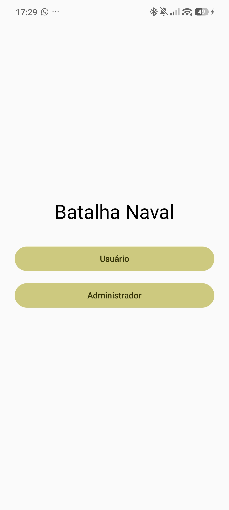
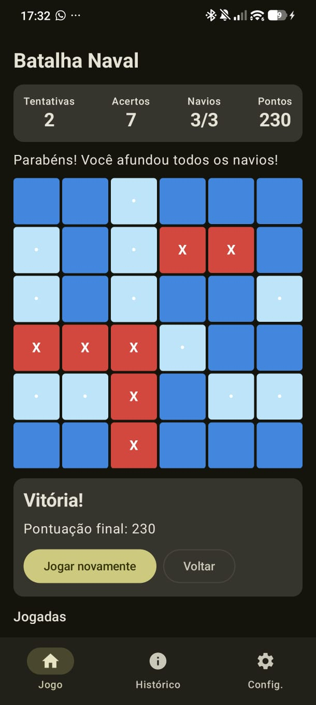
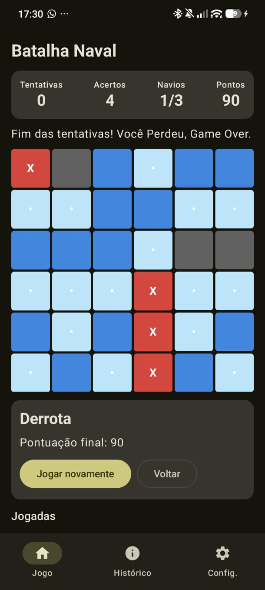
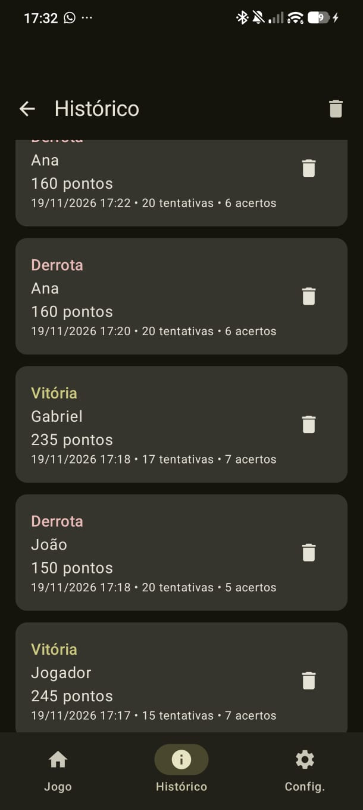
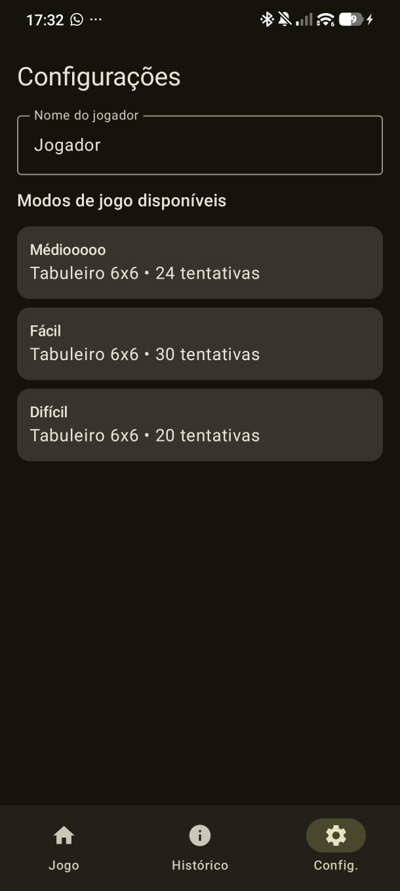
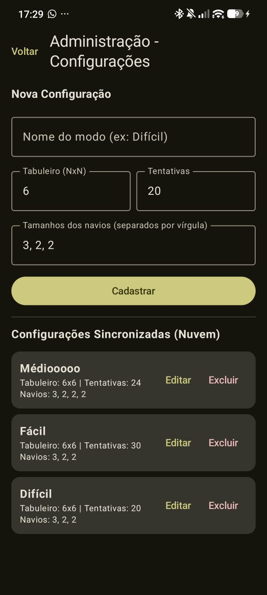

# 🚢 Batalha Naval Android
### Jogo de Batalha Naval contra o computador, com histórico local e administração na nuvem

**Projeto Final: Desenvolvimento de Aplicativos Móveis**

---

## 1. Apresentação do projeto

A **Batalha Naval Android** é um mini-jogo para Android em que o jogador tenta afundar os navios escondidos no tabuleiro pelo computador, dentro de um limite de tentativas.

O aplicativo possui dois perfis de acesso, **Usuário** e **Administrador**, escolhidos na tela inicial (sem login). O perfil fica guardado em um ViewModel e define quais telas podem ser abertas.

O **Usuário** joga, consulta o histórico de partidas salvo no celular e define o nome do jogador. O **Administrador** gerencia, na nuvem, os modos de jogo (tamanho do tabuleiro, navios e número de tentativas).

### Objetivos

- Desenvolver um mini-jogo completo aplicando a arquitetura MVVM.
- Registrar as partidas em um banco de dados local (Room), mantendo os dados após fechar o app.
- Integrar o aplicativo a um serviço externo (Firebase Firestore).
- Separar o acesso de Usuário e Administrador, controlado pelo estado do ViewModel.
- Utilizar Navigation Compose com Bottom Navigation Bar.
- Exibir listas dinâmicas com `LazyColumn`, atualizadas de forma reativa com `Flow`.

---

## 2. Planejamento visual

### Fluxo de navegação

```
                     ┌────────────────────┐
                     │     Tela Início    │
                     │ [Usuário] [Admin]  │
                     └───────┬────────┬───┘
                             │        │
              ┌──────────────┘        └───────────────┐
              ▼                                       ▼
 ┌──────────────────────────────┐        ┌─────────────────────────┐
 │  Modo Usuário                │        │  Modo Administrador     │
 │  (Bottom Navigation Bar)     │        │  Tela de Administração  │
 │                              │        │  Cadastrar / Editar /   │
 │  Jogo | Histórico | Config.  │        │  Excluir modos (nuvem)  │
 │          │                   │        └─────────────────────────┘
 │          ▼                   │
 │   Detalhes da partida        │
 └──────────────────────────────┘
```

### Telas do aplicativo

| # | Tela | Perfil | Descrição |
|---|---|---|---|
| 1 | Início | Todos | Escolha entre Usuário e Administrador |
| 2 | Jogo | Usuário | Tabuleiro, placar e jogadas |
| 3 | Histórico | Usuário | Lista de partidas salvas (Room) |
| 4 | Detalhes da partida | Usuário | Informações de uma partida |
| 5 | Configurações | Usuário | Nome do jogador e modos disponíveis |
| 6 | Administração | Administrador | CRUD dos modos de jogo (Firebase) |

---

## 3. Como utilizar o aplicativo

### 3.1. Tela inicial

Apresenta o título do jogo e dois botões:

- **Usuário:** abre a área do jogador, com a barra de navegação inferior.
- **Administrador:** abre a área de administração.

Não existe autenticação. O botão escolhido grava o perfil no `SessaoViewModel`, e a tela de Administração só é exibida quando o perfil é Administrador.

### 3.2. Jogo

O computador esconde os navios em posições sorteadas do tabuleiro. O jogador toca nas casas para disparar.

| Símbolo | Significado |
|---|---|
| Casa azul escura | Ainda não disparada |
| Casa azul clara com ponto | Água (erro) |
| Casa vermelha com **X** | Acerto em um navio |
| Casa cinza | Navio revelado ao final da partida perdida |

O painel superior mostra **Tentativas** restantes, **Acertos**, **Navios** afundados e **Pontos**. A lista **Jogadas** registra cada disparo.

A partida termina em:

- **Vitória:** todos os navios foram afundados.
- **Derrota:** as tentativas acabaram.

Ao final, o app mostra a pontuação e os botões **Jogar novamente** e **Voltar**. O resultado é salvo automaticamente no banco local.

**Regras da configuração padrão:** tabuleiro 6×6, três navios (tamanhos 3, 2 e 2) e 20 tentativas.

### 3.3. Histórico

Lista as partidas salvas no Room, da mais recente para a mais antiga. No topo, um resumo mostra o total de partidas, vitórias e derrotas.

Cada cartão exibe o resultado (Vitória ou Derrota), o nome do jogador, a pontuação, a data e hora, o número de tentativas e de acertos.

Operações disponíveis:

- **Excluir uma partida:** ícone de lixeira no cartão.
- **Limpar o histórico:** ícone de lixeira na barra superior, com confirmação antes de apagar tudo.

A lista é atualizada automaticamente, pois o Room a entrega por meio de `Flow`.

### 3.4. Detalhes da partida

Mostra as informações de uma partida selecionada: resultado, jogador, pontuação, tentativas e acertos. A tela recebe o identificador da partida como argumento da rota (`detalhes/{id}`).

### 3.5. Configurações

- **Nome do jogador:** campo de texto. O nome informado passa a ser usado nas próximas partidas e aparece no histórico.
- **Modos de jogo disponíveis:** lista com os modos cadastrados pelo Administrador no Firebase (nome, tamanho do tabuleiro e tentativas).

Ao alterar o nome, a partida atual é reiniciada com o novo nome. Por isso, o ideal é alterá-lo antes de jogar.

### 3.6. Administração

Disponível apenas no perfil Administrador. Permite gerenciar os modos de jogo na nuvem:

| Campo | Descrição | Exemplo |
|---|---|---|
| Nome do modo | Identificação do modo | Difícil |
| Tabuleiro (NxN) | Tamanho do tabuleiro | 6 |
| Tentativas | Máximo de disparos | 20 |
| Tamanhos dos navios | Lista separada por vírgula | 3, 2, 2 |

Operações:

- **Cadastrar:** cria um novo modo.
- **Editar:** carrega o modo no formulário e salva as alterações.
- **Excluir:** remove o modo após confirmação.

O app valida os dados antes de salvar (nome preenchido, tabuleiro entre 4 e 12, navios que caibam no tabuleiro e tentativas dentro do limite). A lista **Configurações Sincronizadas (Nuvem)** é atualizada em tempo real. Mensagens de sucesso e erro aparecem na própria tela.

---

## 4. Evidências do aplicativo

### Capturas de tela

**Figura 1: Tela inicial**



**Figura 2: Jogo com vitória**

Tabuleiro com acertos (X), água e painel de pontuação.



**Figura 3: Fim de partida com derrota**

Navios restantes revelados em cinza e pontuação final.



**Figura 4: Histórico de partidas**

Lista reativa com totais de vitórias e derrotas.



**Figura 5: Configurações**

Nome do jogador e modos de jogo vindos do Firebase.



**Figura 6: Administração**

Cadastro de modos e lista sincronizada com a nuvem.



### Vídeo de demonstração

Demonstração do aplicativo em funcionamento no celular: tela inicial, jogo, histórico, configurações e administração.

[▶️ Assistir ao vídeo do aplicativo](https://drive.google.com/file/d/1i-JqitjNY__i6NT9AWRGt9v9IIl9D4nw/view?usp=sharing)

---

## 5. Arquitetura MVVM

O projeto segue a arquitetura MVVM (Model, View, ViewModel):

```
View (Telas Compose)  →  ViewModel  →  Repository  →  DAO / FirebaseService  →  Room / Firestore
```

| Camada | Responsabilidade |
|---|---|
| **View** | Telas em Jetpack Compose. Exibem o estado e enviam as ações do usuário. |
| **ViewModel** | Guarda o estado em `StateFlow`, aplica a lógica e expõe um `UiState`. |
| **Repository** | Única ponte entre os ViewModels e as fontes de dados. Trata falhas com `try-catch`. |
| **DAO / FirebaseService** | Acesso direto ao Room e ao Firestore. |

### ViewModels e UiStates

| ViewModel | UiState | Responsabilidade |
|---|---|---|
| `JogoViewModel` | `JogoUiState` | Regras do jogo: sorteio dos navios, disparos, acertos, pontuação, vitória/derrota e salvamento da partida |
| `HistoricoViewModel` | `HistoricoUiState` | Lista de partidas, totais de vitórias/derrotas, exclusão |
| `AdminViewModel` | `AdminUiState` | CRUD dos modos de jogo no Firestore, validação, mensagens de erro e sucesso |
| `SessaoViewModel` | `SessaoUiState` | Perfil (Usuário/Administrador) e nome do jogador |

Cada ViewModel usa um `MutableStateFlow` privado e expõe um `StateFlow` somente leitura, de modo que as telas observam o estado sem modificá-lo diretamente.

### ViewModelFactory

Os ViewModels do jogo e do histórico recebem o `PartidaRepository` no construtor. A `AppViewModelFactory` ensina o Android a criá-los, entregando a dependência. O `AdminViewModel` possui sua própria `Factory` interna. A `MainActivity` cria o banco, o repositório e a factory e os entrega ao `AppNavHost`.

### Lógica de negócio nas listas

O `HistoricoViewModel` aplica `map` sobre o `Flow` do Room para transformar a lista de partidas em `HistoricoUiState`, calculando o total e as quantidades de vitórias e derrotas com `count`.

---

## 6. Navegação

Foram utilizados **dois `NavController`**, conforme apresentado em aula:

1. **NavController externo** (`AppNavHost`), com as rotas `inicio`, `usuario` e `admin`.
2. **NavController interno** (`TelaUsuario`), dentro do modo Usuário, com `jogo`, `historico`, `configuracoes` e `detalhes/{id}`.

A Bottom Navigation (`NavigationBar` e `NavigationBarItem`) fica no `Scaffold` da `TelaUsuario` e identifica a aba selecionada pela rota atual.

### Bifurcação de acesso (Usuário × Administrador)

O `SessaoViewModel` guarda o perfil escolhido na tela inicial. A rota `admin` só exibe a `TelaAdmin` quando o perfil é `ADMINISTRADOR`. A rota `usuario` oferece a Bottom Navigation com as telas do jogador.

---

## 7. Estrutura de dados

### 7.1. Persistência local: Room

**Entidade Partida** (`Partida.kt`), tabela `partidas`:

| Atributo | Tipo | Responsabilidade |
|---|---|---|
| id | Long | Identificador único (gerado automaticamente) |
| jogador | String | Nome do jogador |
| tentativas | Int | Tentativas utilizadas |
| acertos | Int | Disparos que acertaram navios |
| pontuacao | Int | Pontuação final |
| venceu | Boolean | Resultado da partida |
| dataHoraMillis | Long | Data e hora do registro |

O banco é configurado em `AppDatabase.kt` (padrão Singleton), com DAOs para partidas e configurações. O `PartidaDao` expõe a listagem como `Flow<List<Partida>>`, que o ViewModel coleta para atualizar a interface sem recarregamentos manuais.

### 7.2. Serviço externo: Firebase Firestore

O Administrador gerencia a coleção de **modos de jogo** no Firestore. A modelagem é feita por `data class` com valores padrão (exigência do Firestore para reconstruir o objeto) e a comunicação fica no `FirebaseService`, acessado pelo `ConfiguracaoRepository`.

| Atributo | Tipo | Responsabilidade |
|---|---|---|
| id | String | Identificador do documento |
| nome | String | Nome do modo |
| tamanhoTabuleiro | Int | Tamanho NxN |
| tamanhosNavios | List<Int> | Tamanho de cada navio |
| tentativasMaximas | Int | Limite de disparos |

### 7.3. Operações CRUD

| Operação | Room (partidas) | Firestore (modos de jogo) |
|---|---|---|
| Create | Salvar partida ao final do jogo | Cadastrar modo |
| Read | Histórico via `Flow` | Lista em tempo real |
| Update | — | Editar modo |
| Delete | Excluir partida / limpar histórico | Excluir modo |

### 7.4. Tratamento de exceções

O `ConfiguracaoRepository` isola as falhas do Firebase com `try-catch` e devolve o resultado em `Result`. O `AdminViewModel` converte o erro em mensagem exibida no `AdminUiState`, de modo que a tela mostra o problema sem encerrar o aplicativo.

---

## 8. Organização do projeto

```
app/src/main/java/com/example/batalhanaval/
├── MainActivity.kt
├── data/
│   ├── AppDatabase.kt            Configuração do Room
│   ├── Partida.kt                Entidade do histórico
│   ├── PartidaRepository.kt      Repositório (Room)
│   ├── ConfiguracaoRepository.kt Repositório (Firebase, com try-catch)
│   ├── FirebaseService.kt        Acesso ao Firestore
│   ├── ConfiguracaoJogo.kt       Modelo dos modos de jogo
│   ├── dao/                      PartidaDao e ConfiguracaoDao
│   └── model/                    Modelos auxiliares
└── ui/
    ├── admin/                    AdminViewModel, AdminUiState, TelaAdmin
    ├── configuracoes/            TelaConfiguracoes
    ├── detalhes/                 TelaDetalhes
    ├── historico/                HistoricoViewModel, HistoricoScreen
    ├── inicio/                   TelaInicio
    ├── jogo/                     JogoViewModel, JogoUiState, TelaJogo
    ├── navigation/               Rotas, AppNavHost (NavHost + Bottom Navigation)
    ├── viewmodel/                SessaoViewModel, AppViewModelFactory
    └── theme/                    Cores, tipografia e tema
```

---

## 9. Requisitos do projeto × implementação

| Requisito | Onde foi atendido |
|---|---|
| MVVM com pacotes separados | `ui`, `data` (Room, Firebase e repositórios), `dao`, `viewmodel` |
| Mínimo 2 ViewModels com `UiState` próprio | `JogoViewModel`, `HistoricoViewModel`, `AdminViewModel`, `SessaoViewModel` |
| `ViewModelFactory` | `AppViewModelFactory` e `AdminViewModel.Factory` |
| Tratamento de exceções no Repository | `try-catch` em `ConfiguracaoRepository`, erro exposto no `AdminUiState` |
| Mínimo 2 `@Entity` no Room | Entidades `Partida` e `Configuracao` no `AppDatabase` |
| Listagem reativa com `Flow` | `PartidaDao` → `PartidaRepository` → `HistoricoViewModel` |
| CRUD | Room (inserir, listar, excluir) e Firestore (cadastrar, listar, editar, excluir) |
| Integração externa | Firebase Firestore |
| Mínimo 6 telas/destinos | Início, Jogo, Histórico, Detalhes, Configurações e Administração |
| Bottom Navigation Bar | `NavigationBar` na `TelaUsuario` |
| `map`/`filter`/`sortedBy` no ViewModel | `map` e `count` no `HistoricoViewModel` |
| `LazyColumn` | Histórico, Configurações, Administração e Jogadas |
| Bifurcação de acesso Admin × Jogador | `SessaoViewModel` + rota `admin` condicionada ao perfil |

---

## 10. Tecnologias utilizadas

| Tecnologia | Aplicação no projeto |
|---|---|
| Kotlin | Linguagem de programação |
| Android Studio | Ambiente de desenvolvimento |
| Jetpack Compose | Interface |
| Material Design 3 | Componentes visuais |
| Navigation Compose | Navegação entre telas |
| ViewModel e StateFlow | Estado das telas |
| Room e SQLite | Persistência local |
| KSP | Processamento das anotações do Room |
| Firebase Firestore | Dados na nuvem (modos de jogo) |
| Coroutines e Flow | Operações assíncronas e listas reativas |
| Git e GitHub | Versionamento e trabalho em equipe |

---

## 11. Como executar o projeto

### Obter o código

```
git clone https://github.com/JoaoBaptistaJK-pixel/batalha-naval-android.git
```

Ou use **Code → Download ZIP** no GitHub.

### Abrir e executar

1. Abra o Android Studio e clique em **Open**.
2. Selecione a pasta do projeto e aguarde a sincronização do Gradle.
3. Confirme que o arquivo `app/google-services.json` está presente (já incluído no repositório).
4. Selecione a configuração `app`.
5. Escolha um emulador ou um celular com depuração USB.
6. Clique em **Run**.

**Observação:** o modo Administrador precisa de conexão com a internet para sincronizar com o Firestore. O modo Usuário (jogo e histórico) funciona offline.

---

## 12. Dificuldades encontradas e soluções

### Trabalho em equipe com Git

Quatro pessoas desenvolveram em paralelo, cada uma em sua branch (`feature/database`, `feature/game-engine`, `feature/admin`, `feature/navigation`).

**Solução:** a integração foi feita por Pull Requests para a `main`. A navegação foi montada por último, sobre o código já integrado dos colegas.

### Integração das partes

Os arquivos de cada integrante dependiam uns dos outros. O `JogoViewModel` importava classes do banco que ainda não estavam na `main`, o que impedia o projeto de compilar.

**Solução:** o banco foi integrado primeiro, e as dependências (Room, KSP, Navigation Compose) foram centralizadas no `build.gradle.kts` para evitar conflitos.

### Arquivo do Firebase

O plugin do Google Services exige o `google-services.json`, que não estava no repositório e impedia a compilação nas outras máquinas.

**Solução:** o arquivo foi adicionado ao repositório (ajustando o `.gitignore`) para que o projeto funcione para todos.

### Botão Voltar da Administração

Ao voltar da tela de Administração o app travava, porque o botão executava duas voltas na pilha de navegação (uma ao limpar o perfil e outra pela própria tela).

**Solução:** o botão passou a executar uma única volta. O perfil é regravado a cada escolha na tela inicial.

### Nome do jogador não chegava ao jogo

O jogo só era iniciado quando o tabuleiro estava vazio, então um nome alterado depois não era aplicado.

**Solução:** a `TelaUsuario` reinicia o jogo com o nome atual do `SessaoViewModel` sempre que ele muda.

### Emulador

O emulador travava com a mensagem de que já estava em execução.

**Solução:** os testes passaram a ser feitos em um celular físico com depuração USB.

---

## 13. Testes de funcionamento

### Jogo

| Teste | Resultado esperado |
|---|---|
| Tocar em uma casa nova | A casa muda para água ou acerto |
| Tocar em casa já usada | Nada acontece |
| Afundar todos os navios | Mensagem de vitória e pontuação |
| Acabar as tentativas | Derrota e navios restantes revelados |
| Jogar novamente | Novo tabuleiro com novo sorteio |

### Histórico (Room)

| Teste | Resultado esperado |
|---|---|
| Terminar uma partida | Partida aparece no Histórico |
| Excluir uma partida | Registro removido e totais atualizados |
| Limpar histórico | Confirmação e remoção de todas |
| Fechar e reabrir o app | Partidas continuam salvas |

### Configurações e navegação

| Teste | Resultado esperado |
|---|---|
| Alterar o nome e jogar | Nome novo aparece no Histórico |
| Trocar de aba | Bottom Navigation destaca a aba atual |
| Entrar como Administrador e voltar | Retorna ao início sem travar |

### Administração (Firebase)

| Teste | Resultado esperado |
|---|---|
| Cadastrar modo | Aparece na lista da nuvem e em Configurações |
| Dados inválidos | Mensagem de validação |
| Editar modo | Dados atualizados |
| Excluir modo | Removido após confirmação |

---

## 14. Limitações conhecidas e melhorias futuras

- O modo de jogo escolhido na nuvem ainda não altera as regras da partida; o jogo usa a configuração padrão (6×6, navios 3, 2 e 2, 20 tentativas).
- Existe mais de um modelo de configuração no projeto (versões do Room e do Firebase) que pode ser unificado.
- Incluir a operação de edição (Update) também no banco local.
- Permitir ao jogador escolher o modo de jogo e aplicar o tabuleiro correspondente.
- Adicionar ranking com filtros e ordenação por pontuação.
- Adicionar tela de detalhes acessível diretamente pelo toque no histórico.
- Autenticação real para o Administrador.

---

## 15. Considerações finais

O projeto reuniu em um único aplicativo os conceitos estudados no semestre: Kotlin, Jetpack Compose, Navigation Compose, ViewModel, Room, Flow e integração com serviço externo, organizados na arquitetura MVVM.

O resultado é um jogo funcional, com histórico persistente no celular, administração conectada à nuvem e acesso separado por perfil. O desenvolvimento em equipe, com branches e Pull Requests, também permitiu praticar fluxo de trabalho com Git e GitHub.

---

## 16. Integrantes e participação da equipe

**Projeto:** Batalha Naval Android

| Integrante | Responsabilidade |
|---|---|
| Pedro Vasconcelo | Banco de dados local (Room), `PartidaRepository`, histórico de partidas |
| Brayan | Motor do jogo, `JogoViewModel` e tela de jogo |
| João Rubens Brandt Neto | Administração, `AdminViewModel` e integração com Firebase Firestore |
| João Vitor Baptista | Navegação (NavHost e Bottom Navigation), `SessaoViewModel`, `AppViewModelFactory`, tela inicial, detalhes e configurações |

O trabalho foi dividido por áreas de responsabilidade, com cada integrante desenvolvendo em sua branch e integrando à `main` por Pull Request. Ao final, o grupo testou o aplicativo completo e corrigiu os problemas de integração.
